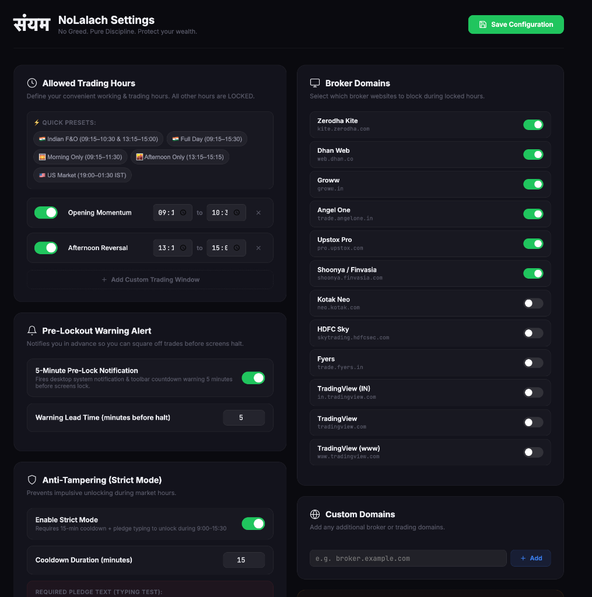
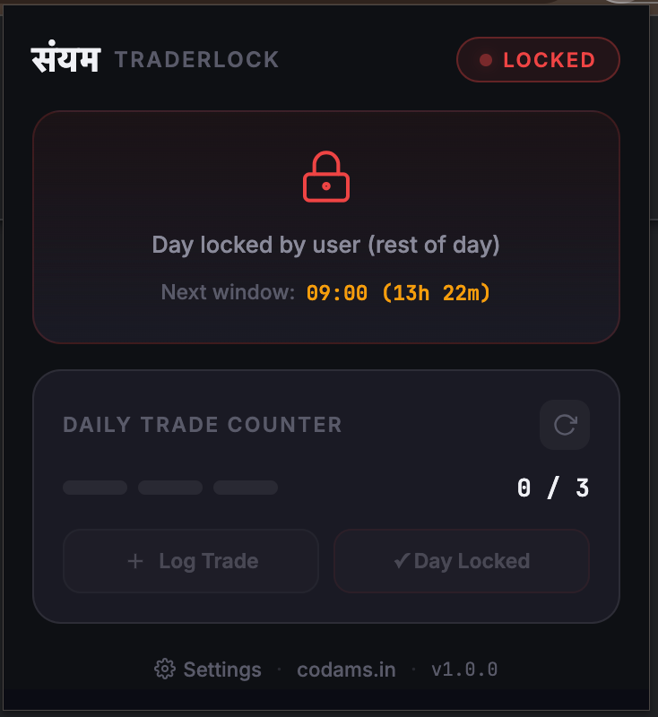
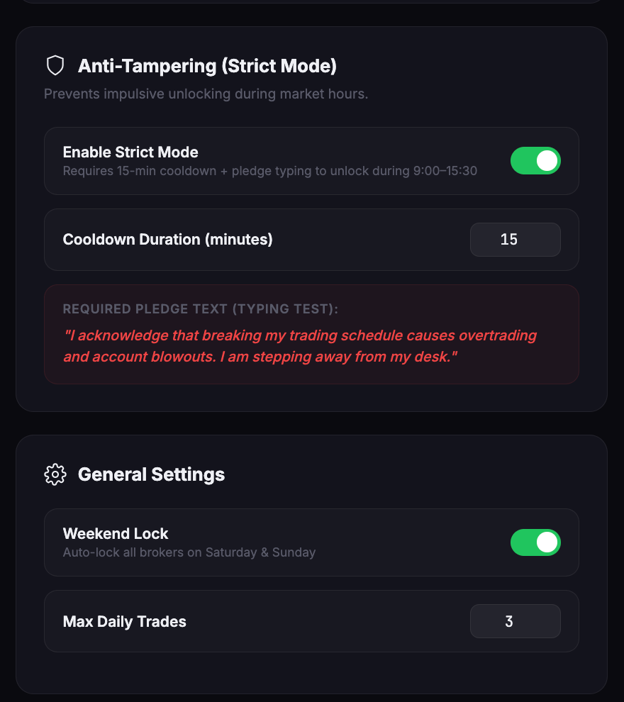

# Codams - Building Smart Software Solutions

A modern, responsive web application for Codams - a software development company specializing in web development, WhatsApp bots, API integration, and automation tools.

## 🚀 Project Overview

Codams is built with cutting-edge web technologies to provide a seamless user experience while showcasing the company's quantitative trading engines, algorithmic trading architecture, and proprietary software products.

---

## 🔒 Featured Open-Source Product: NoLalach (नो लालच)

Codams is proud to maintain and sponsor **[NoLalach (नो लालच)](https://github.com/codams-tech/NoLalach)** — an open-source Manifest V3 browser extension built to eliminate overtrading, revenge trading, and impulsive account blowouts for retail and options traders.

- **Repository**: [codams-tech/NoLalach](https://github.com/codams-tech/NoLalach)
- **Tagline**: *"No Greed. Pure Discipline. Protect your wealth."*
- **License**: MIT (100% Free Forever)
- **Architecture**: Zero telemetry, 100% offline, bulletproof pre-render broker interception

### Product Showcase

<p align=center>
  
  <br>
  <em>High-friction broker lockout screen enforcing discipline during low-probability chop zones (10:30 AM – 1:15 PM)</em>
</p>

<p align="center">
  
  <br>
  <em>Allowed trading hours with quick presets, 5-minute pre-lock warning alert, and broker selection</em>
</p>

<p align="center">
  
  &nbsp;&nbsp;&nbsp;&nbsp;
  
  <br>
  <em>Left: Toolbar monitor with live countdown & trade limit circuit breaker. Right: Anti-tampering 15-min cooldown pledge.</em>
</p>

## ✨ Features

- **Responsive Design**: Optimized for all devices (mobile, tablet, desktop)
- **Modern UI**: Built with shadcn/ui components and Tailwind CSS
- **Contact Form**: Integrated with Formspree for lead generation
- **WhatsApp Integration**: Direct WhatsApp contact functionality
- **Environment Configuration**: Secure environment variable management
- **TypeScript**: Full type safety for better development experience

## 🛠️ Technologies Used

### Core Framework
- **React 18.3.1** - Modern React with hooks and concurrent features
- **TypeScript** - Type-safe JavaScript development
- **Vite** - Fast build tool and development server

### UI & Styling
- **Tailwind CSS** - Utility-first CSS framework
- **shadcn/ui** - High-quality React components built on Radix UI
- **Lucide React** - Beautiful icon library
- **React Icons** - Additional icon set

### Forms & Validation
- **React Hook Form** - Performant forms with easy validation
- **@hookform/resolvers** - Validation schema integration
- **Radix UI Components** - Accessible form primitives

### State Management & Data
- **@tanstack/react-query** - Server state management
- **React Router DOM** - Client-side routing

### Development Tools
- **ESLint** - Code linting and quality assurance
- **Sonner** - Toast notifications

## 📋 Prerequisites

- Node.js (v16 or higher)
- npm or yarn package manager

## 🚀 Getting Started

### 1. Clone the Repository

```bash
git clone https://github.com/codams-org/codams-org.github.io.git
cd codams-org.github.io
```

### 2. Install Dependencies

```bash
npm install
```

### 3. Environment Setup

Copy the environment template and configure your variables:

```bash
cp .env.example .env
```

Edit the `.env` file with your actual values:

```env
VITE_CONTACT_PHONE_PRIMARY=+91XXXXXXXXXX
VITE_CONTACT_EMAIL=your-email@codams.com
VITE_WHATSAPP_PHONE=91XXXXXXXXXX
VITE_WHATSAPP_DEFAULT_MESSAGE="Hello! I'm interested in your services."
VITE_COMPANY_ADDRESS="Your Address, City- Pincode"
VITE_COMPANY_COUNTRY="Your Country"
```

### 4. Start Development Server

```bash
npm run dev
```

The application will be available at `http://localhost:5173`

## 📜 Available Scripts

- `npm run dev` - Start development server with hot reload
- `npm run build` - Create optimized production build
- `npm run build:dev` - Create development build
- `npm run lint` - Run ESLint for code quality checks
- `npm run preview` - Preview production build locally

## 🏗️ Build & Deployment

### Production Build (local)

```bash
npm run build
```

This creates an optimized production build in the `dist` folder that is used by GitHub Actions when deploying.

### Preview Production Build (local)

```bash
npm run preview
```

## 📁 Project Structure

```
src/
├── components/          # Reusable React components
│   ├── ui/             # shadcn/ui components
│   ├── Footer.tsx      # Footer component
│   ├── Contact.tsx     # Contact form component
│   └── WhatsAppButton.tsx # WhatsApp integration
├── assets/             # Static assets (images, etc.)
├── lib/                # Utility functions
├── hooks/              # Custom React hooks
└── App.tsx            # Main application component
```

## 🔧 Configuration

### Environment Variables

The application uses environment variables for configuration:

- `VITE_CONTACT_PHONE_PRIMARY` - Primary contact phone number
- `VITE_CONTACT_EMAIL` - Contact email address
- `VITE_WHATSAPP_PHONE` - WhatsApp number (without +)
- `VITE_WHATSAPP_DEFAULT_MESSAGE` - Default WhatsApp message
- `VITE_COMPANY_ADDRESS` - Company address
- `VITE_COMPANY_COUNTRY` - Company country

These variables are injected automatically in the GitHub Actions workflow using the `codams-web-env` environment (see `.github/workflows/deploy.yml`).

Locally, you can create a `.env` file in the project root:

```env
VITE_CONTACT_PHONE_PRIMARY=+91XXXXXXXXXX
VITE_CONTACT_EMAIL=your-email@codams.com
VITE_WHATSAPP_PHONE=91XXXXXXXXXX
VITE_WHATSAPP_DEFAULT_MESSAGE="Hello! I'm interested in your services."
VITE_COMPANY_ADDRESS="Your Address, City- Pincode"
VITE_COMPANY_COUNTRY="Your Country"
```

### Automatic Deployment (GitHub Pages)

- The site is deployed automatically by GitHub Actions using the workflow in:
  - `.github/workflows/deploy.yml`
- Branch roles:
  - `master` is the main development branch where you do day-to-day work.
  - `main` is the deployment branch. **Pushes to `main` trigger deployment.**
- The workflow:
  - Runs on pushes to the `main` branch.
  - Uses the `codams-web-env` environment for production `VITE_` variables.
  - Builds the app with `npm run build`.
  - Uploads the `dist` folder as a GitHub Pages artifact.
  - Publishes the site to GitHub Pages with the custom domain `codams.in`.

Typical flow:

1. Work on `master`:

```bash
git checkout master
# edit code
git add .
git commit -m "Your change"
git push origin master
```

2. Merge into `main` and deploy:

```bash
git checkout main
git merge master
git push origin main
```

Pushing to `main` will trigger the GitHub Actions workflow and deploy the updated site.

### Formspree Integration

The contact form is integrated with Formspree for form submissions. Update the form endpoint in `src/components/Contact.tsx`:

```typescript
const response = await fetch("https://formspree.io/f/your-form-id", {
  // ...
});
```

## 🎨 Customization

### Theming

The application uses Tailwind CSS with CSS variables for theming. Customize colors and styles in:

- `tailwind.config.ts` - Tailwind configuration
- `src/index.css` - Global styles and CSS variables

### Components

All UI components are built with shadcn/ui and can be customized or extended as needed.

## 📱 Browser Support

- Chrome (latest)
- Firefox (latest)
- Safari (latest)
- Edge (latest)

## 🤝 Contributing

1. Fork the repository
2. Create a feature branch (`git checkout -b feature/amazing-feature`)
3. Commit your changes (`git commit -m 'Add some amazing feature'`)
4. Push to the branch (`git push origin feature/amazing-feature`)
5. Open a Pull Request

## 📄 License

This project is proprietary to Codams. All rights reserved.

## 📞 Contact

- Email: info@codams.com
- Phone: +91-9013207895
- Address: Gurugram, Haryana- 122001, India

---

Built with ❤️ by Codams Team
